# Paperless Budget

**Haushaltsbudget, Kontoauszug-Abgleich und Fahrzeugkosten – direkt aus deinen Belegen in [Paperless-ngx](https://github.com/paperless-ngx/paperless-ngx).**

> *English summary:* A self-hosted budgeting web app that uses the Paperless-ngx REST API as its data source.
> Invoices and receipts with a monetary custom field become expenses, tags become budget categories.
> It parses (Swiss) bank statement PDFs from Paperless, reconciles payments with invoices and marks them as paid,
> and tracks vehicle costs with mileage from [Traccar](https://www.traccar.org/) (cost per km, fuel consumption).
> For landlords it manages buildings, flats, fixed distribution keys, rent payments and generates the yearly
> Swiss utility bill ("Heiz- und Nebenkostenabrechnung") as Word/PDF. Projects collect full or partial receipts.
> UI and docs are in German.

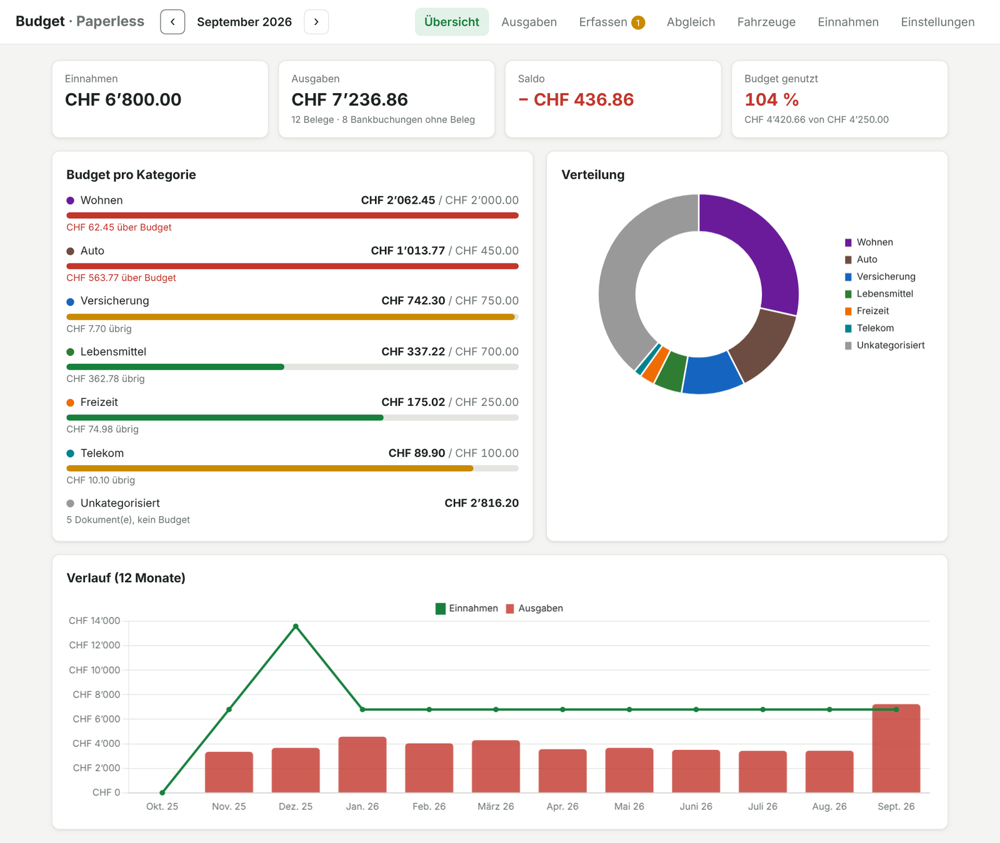

## Warum?

Wer seine Rechnungen und Quittungen ohnehin in Paperless-ngx archiviert, hat die Daten für ein Haushaltsbudget
schon beisammen. Paperless Budget macht daraus Auswertungen, ohne die Belege ein zweites Mal zu erfassen:
Paperless bleibt die einzige Quelle für Belege, die App ergänzt nur Budgets, Einnahmen, Regeln und
Kontobewegungen.

## Funktionen

### Budget
- **Ausgaben aus Paperless**: Dokumente mit einem Custom Field vom Typ *Währung* (Standard: „Total“)
- **Kategorien über Paperless-Tags**: frei wählbar, mit Monatsbudget und Warnung bei Überschreitung
- **Dashboard**: Einnahmen, Ausgaben, Saldo, Verteilung nach Kategorie, 12-Monats-Verlauf
- **Erfassen**: Belege ohne Betrag mit OCR-Ausschnitt anzeigen, Betrag und Kategorie eintippen –
  wird direkt in Paperless zurückgeschrieben
- **Einnahmen**: einmalig oder monatlich wiederkehrend
- **Zweck automatisch erkannt**: Die App liest aus dem Rechnungstext, wofür ein Beleg ist (Betreff,
  Zahlungszweck, QR-Rechnung, erste Position) und zeigt es in der Übersicht – korrigierbar per Klick
- **Nicht berücksichtigen**: Häkchen entfernen und optional einen Grund angeben (z.B. „Geschäftlich“,
  „Rückerstattet“) – oder ganze Paperless-Tags wie „Geschäft“ automatisch ausschliessen

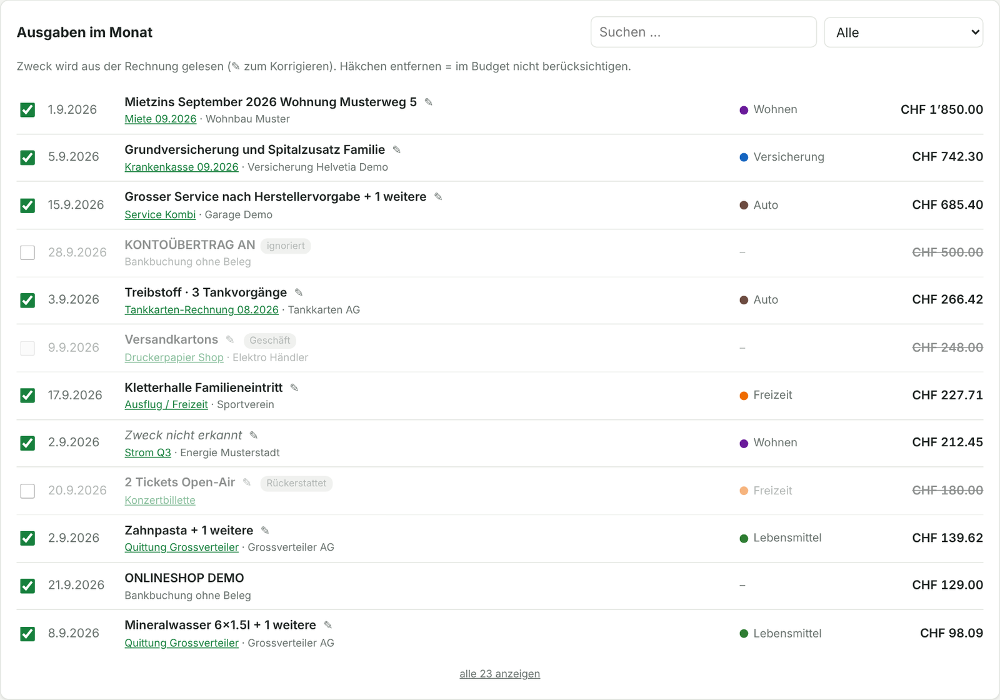

### Abgleich mit Kontoauszügen
- **PDF-Kontoauszüge aus Paperless einlesen** (OCR-Text) – das Layout wird automatisch erkannt
- **Jede Buchung wird über den Saldo geprüft**, auch über Seitenumbrüche hinweg
- **Zahlungen mit Rechnungen abgleichen** (Betrag, Datum, Name im Buchungstext); bei Treffer setzt die App
  in Paperless den Tag „bezahlt“ und das Datumsfeld „Bezahlt am“
- **Zahlungen ohne Beleg** (z.B. Kartenzahlungen) zählen ins Budget; **Regeln** ordnen sie automatisch zu
  oder ignorieren Umbuchungen
- **Offene Rechnungen**: Belege, zu denen noch keine Zahlung gefunden wurde

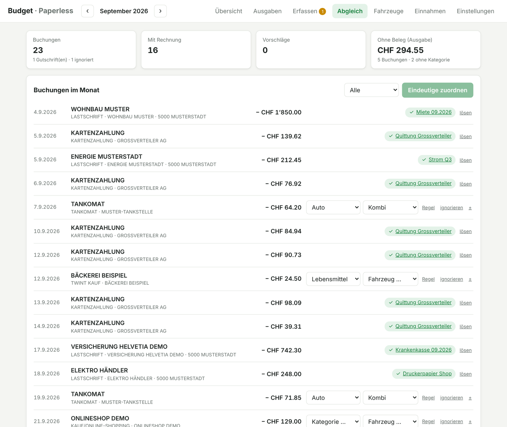

### Fahrzeuge
- **Kosten pro Fahrzeug** aus Tankkarten-Rechnungen, Paperless-Belegen (Fahrzeug-Tag) und Bankbuchungen
- **Kilometer aus Traccar** pro Monat
- **Kennzahlen**: Kosten/km, Treibstoff/km, Verbrauch (L oder kWh/100 km), Preis pro Liter/kWh
- **Tankkarten-Rechnungen** werden pro Tankvorgang gelesen und über die Kartennummer dem Fahrzeug zugeteilt

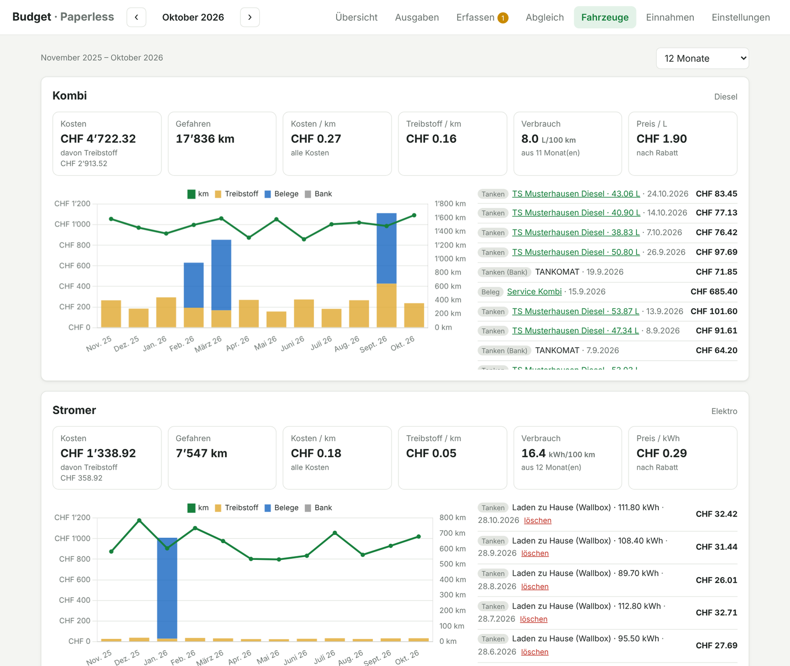

### Immobilien & Nebenkostenabrechnung
- **Häuser und Wohnungen** mit Fläche, Eigennutzung und Mietverhältnissen (Miete, Akonto, Ein-/Auszug)
- **Verteilschlüssel** mit festen Prozenten pro Wohnung, nach Fläche oder gleichmässig
- **Kostenarten** wie in der klassischen Heiz- und Nebenkostenabrechnung: Heizpool (Heizöl, Strom, Kaminfeger …)
  wird auf Raumheizung/Warmwasser aufgeteilt, übrige Kosten (Wasser, Entsorgung, Hauswart …) per Schlüssel
- **Kosten aus drei Quellen**: Paperless-Belege (über Tag oder Zuordnung, auch Teilbeträge), **Fixkosten**
  (pro Jahr/Monat) und **manuelle Kosten** – jeweils verteilt oder **individuell einer Wohnung** belastet
- **Automatisch erkannt**: Kostenart über Stichworte, Menge (z.B. „2'700 Liter“) aus dem Beleg
- **Mietzinseingänge** aus den Kontoauszügen, Monatsübersicht mit Ausständen
- **Abrechnung pro Mieter** nach Nutzungstagen, mit Akonto, Rundung auf 5 Rappen – als **Word und PDF**,
  automatisch in Paperless abgelegt; Übersicht über Mieteranteile, Eigennutzung und Leerstand

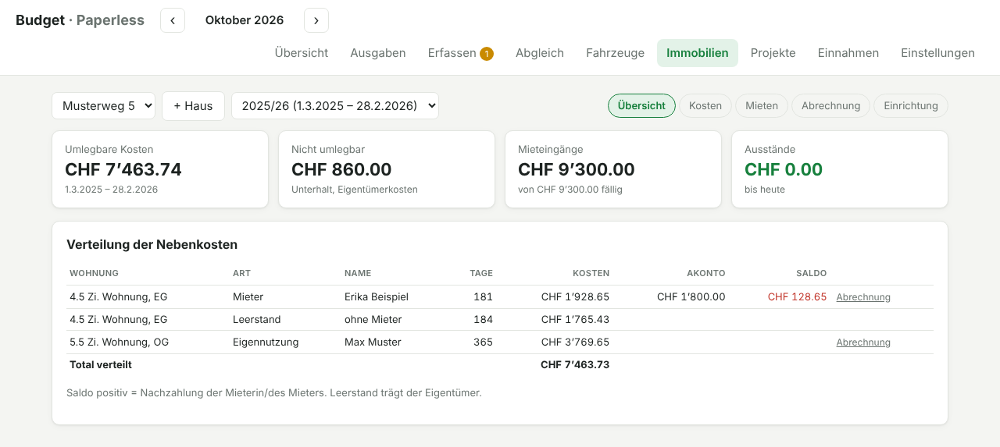
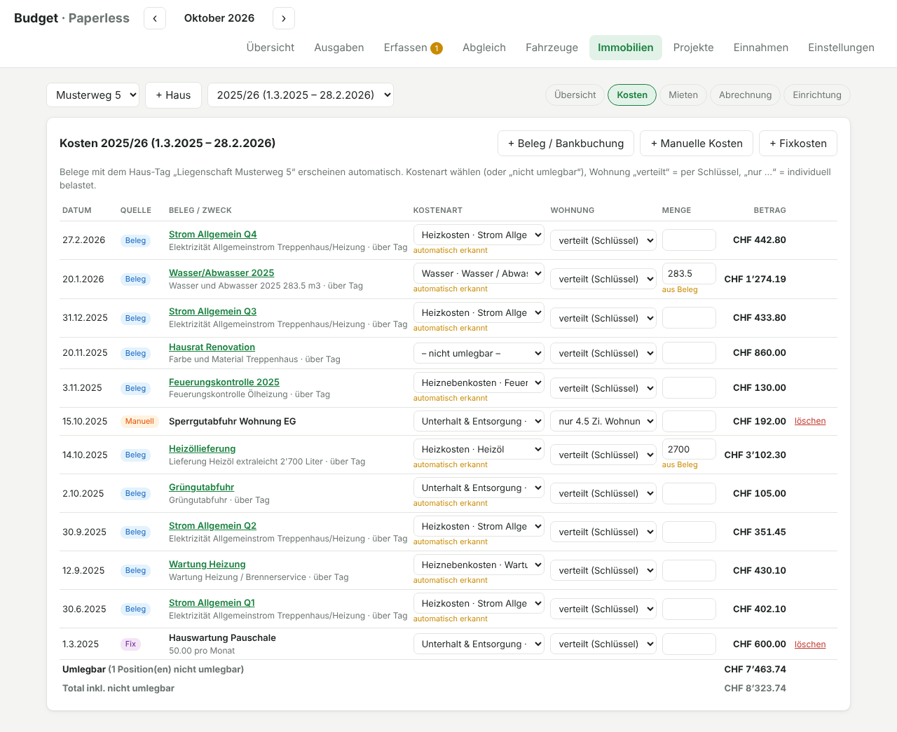

<details>
<summary>Abrechnung: Vorschau und erzeugtes Dokument</summary>

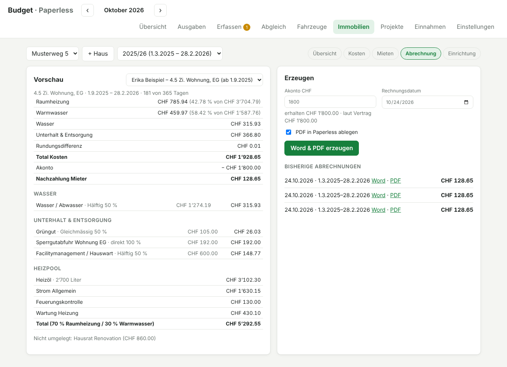
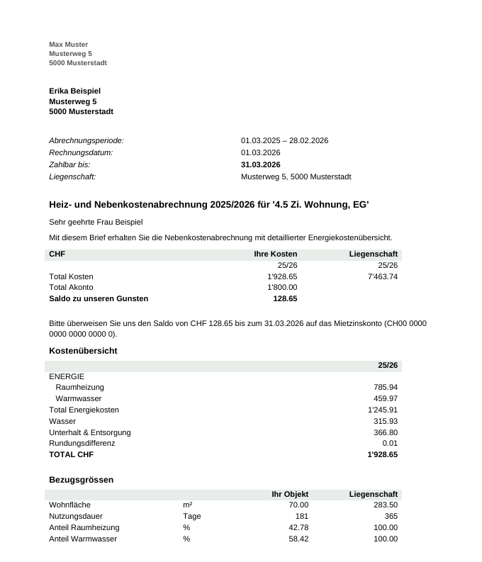
</details>

### Projekte
- Projekte mit Budget, z.B. Umbau oder Gartenhaus
- Belege und Bankbuchungen **ganz oder anteilig** zuordnen (Prozent oder Betrag) – oder über einen Paperless-Tag
- Optional „nicht im Haushaltsbudget“ (z.B. für geschäftliche Projekte)

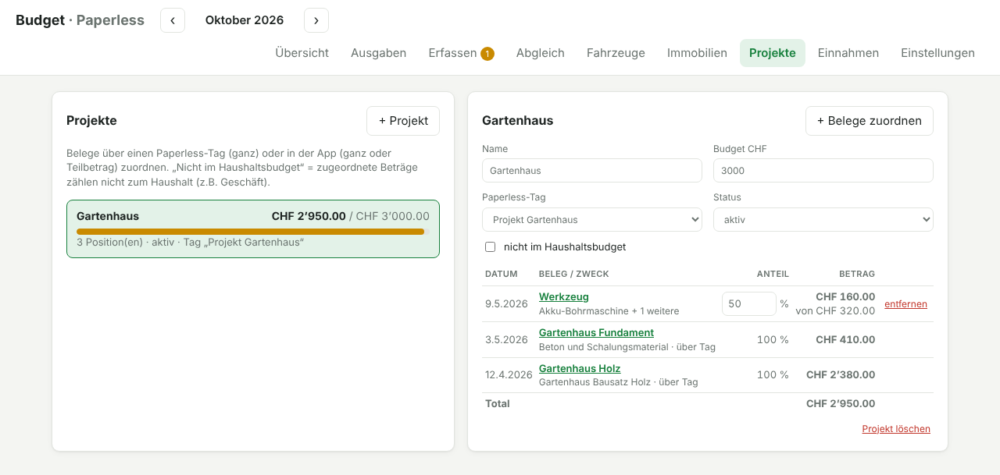

### Rest vom Lohn & Vormerkungen
- Kachel in der Übersicht: Einnahmen − bereits ausgegeben − noch fällige Vertrags-/Kreditzahlungen − vorgemerkte
  Bestellungen = **frei verfügbar** (Jahresprämien in voller Höhe im Monat der Fälligkeit)
- **Bestellungen vormerken**: von Hand oder automatisch aus Bestellbestätigungen in Paperless (Tag „Bestellung“,
  z.B. per Mail-Regel importiert); der Betrag wird aus dem Text gelesen
- Sobald Rechnung oder Abbuchung vom gleichen Händler mit gleichem Betrag da ist, wird die Vormerkung automatisch erledigt

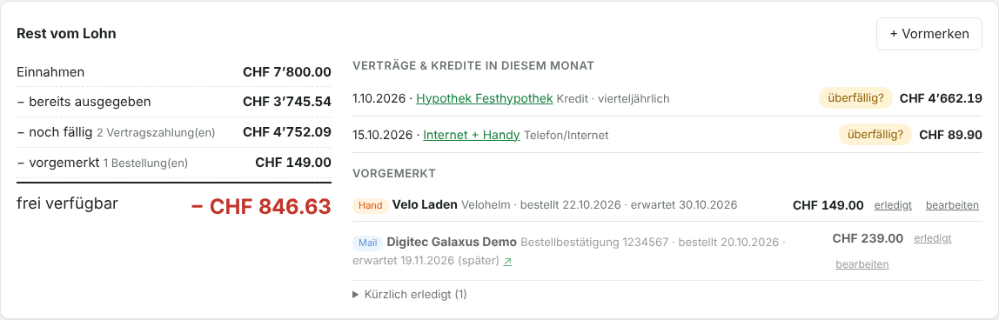

### Abos
- Eigener Tab mit allen Abos (Streaming, Musik, Software, Zeitung, Fitness …): Kosten pro Monat/Jahr, nächste Abbuchung,
  letzte Zahlung, Kündigungstermin
- **Erkennt wiederkehrende Zahlungen** in den Kontoauszügen (gleicher Händler, gleicher Betrag, monatlich/quartalsweise/jährlich)
  und bekannte Abo-Anbieter – mit einem Klick als Abo übernehmen oder als „kein Abo“ ausblenden
- Abos sind Verträge: Preisänderungen, Zahlungen und Belege unter „Details“

### Zähler & erwartete Abrechnung
- Strom vom AMS-Leser, später Wasser (Shelly) oder ein beliebiger Home-Assistant-Sensor – automatisch abgelesen
- Verbrauch seit Periodenbeginn, Hochrechnung bis Periodenende (wie Vorjahr oder Tagesdurchschnitt)
- Erwartete Rechnung mit Tarif und Grundgebühr, minus bezahlte und noch fällige Akonto-Zahlungen → Nachzahlung oder Guthaben
- Zähler pro Haus (allgemein) oder Wohnung; Allgemeinstrom erscheint in der NK-Abrechnung als „(erwartet …)“

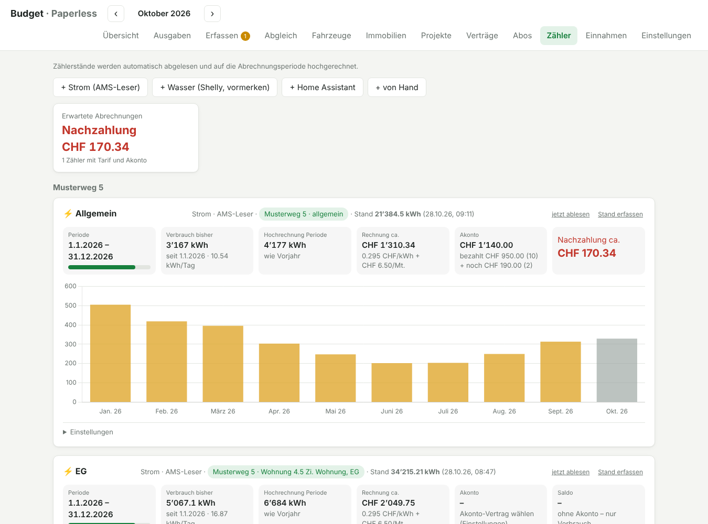

### Verträge & Kredite
- Verträge mit Preis-Versionen, Kosten pro Monat/Jahr, Kündigungsterminen und Zahlungen aus den Kontoauszügen
- Kredite mit Restschuld, Zins und Amortisationsplan
- Vertragsdokumente direkt aus Paperless (über Korrespondent oder Tag)

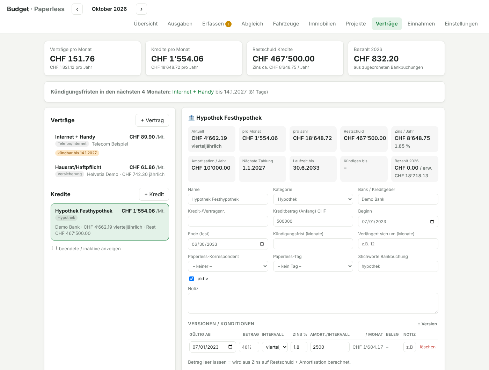

<details>
<summary>Weitere Ansicht: Belege nacherfassen</summary>

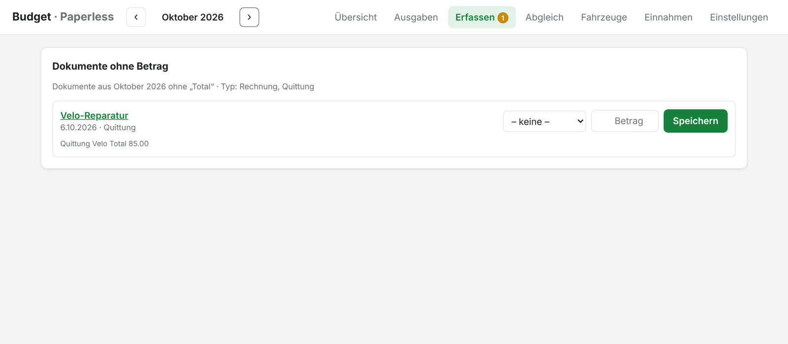
</details>

*Alle Screenshots zeigen erfundene Demo-Daten.*

## Voraussetzungen

- Docker und Docker Compose
- Paperless-ngx 2.x (mit Custom Fields) und ein API-Token
- optional: Traccar (für Fahrzeug-Kilometer)

## Installation

```bash
git clone https://github.com/pebu1977/paperless-budget.git
cd paperless-budget
cp .env.example .env
nano .env            # PAPERLESS_URL, PAPERLESS_TOKEN, PAPERLESS_PUBLIC_URL eintragen
docker compose up -d --build
```

Danach `http://<host>:8088` öffnen.

**API-Token**: In Paperless oben rechts auf den Benutzer → *Mein Profil* → *API-Auth-Token*.
Am besten einen eigenen Paperless-Benutzer anlegen, der nur Dokumente sehen und bearbeiten darf.

**Paperless auf demselben Docker-Host**: `docker-compose.override.example.yml` nach
`docker-compose.override.yml` kopieren, den Netzwerknamen mit `docker network ls` prüfen und `PAPERLESS_URL`
auf den Container setzen, z.B. `http://paperless-webserver-1:8000`. Die Override-Datei wird von Git ignoriert
und bei Updates nicht überschrieben.

> [!IMPORTANT]
> Die App kann Dokumente in Paperless ändern und zeigt Finanzdaten. Nicht ungeschützt ins Internet stellen –
> hinter einen Reverse Proxy mit Zugriffsschutz (z.B. Nginx Proxy Manager mit Access List) oder
> `BASIC_AUTH_USER` / `BASIC_AUTH_PASSWORD` in der `.env` setzen.

### Aktualisieren

```bash
cd paperless-budget
git pull
docker compose up -d --build
```

`.env`, `data/` und `docker-compose.override.yml` bleiben unberührt; die Datenbank wird beim Start automatisch
auf den neuen Stand gebracht. Vorher `data/` sichern schadet nie.

## Einrichtung

1. **Übersicht**: Fehlt das Betrags-Feld in Paperless, legt die App es per Knopfdruck an.
2. **Einstellungen → Verbindung & Status**: zeigt, ob Paperless und Traccar erreichbar sind und ob die
   benötigten Tags/Felder existieren – fehlende lassen sich per Knopf anlegen.
3. **Einstellungen → Budget**: Tags als Kategorien anhaken, Reihenfolge festlegen
   (hat ein Dokument mehrere, zählt der oberste), Monatsbudgets eintragen, Tags „nie im Budget“ wählen.
4. **Einstellungen → Belege & Erfassen**: z.B. nur Dokumenttyp *Rechnung* und *Quittung*.
5. **Einnahmen**: unter *Automatisch aus Kontoauszügen* eine Regel für den Lohn anlegen (Stichwort, z.B. Name des
   Arbeitgebers – am einfachsten bei der Lohn-Gutschrift „als Einnahme erkennen“ klicken). Erkannte Gutschriften zählen als
   Einnahme; fehlt sie im laufenden Monat noch, zählt der erwartete Betrag. Andere Einnahmen von Hand erfassen.
   **Lohnabrechnungen** (Titel mit „Lohnabrechnung“ oder Dokumenttyp/Tag) liest die App ebenfalls: Brutto, Abzüge
   (AHV/ALV, PK, Versicherungen, Quellensteuer), Netto und ausbezahlter Betrag – mit Abgleich gegen die Gutschrift und
   Jahresübersicht pro Person (praktisch für die Steuererklärung). Ohne Gutschrift zählt der Betrag aus der Abrechnung.

Die Einstellungen sind in Rubriken gegliedert (Budget, Belege, Bank & Abgleich, Vormerkungen, Fahrzeuge,
Verträge, Immobilien, Daten & Wartung) und werden sofort gespeichert. Unter **Daten & Wartung** gibt es
Backup/Wiederherstellung der App-Datenbank und CSV-Exporte.

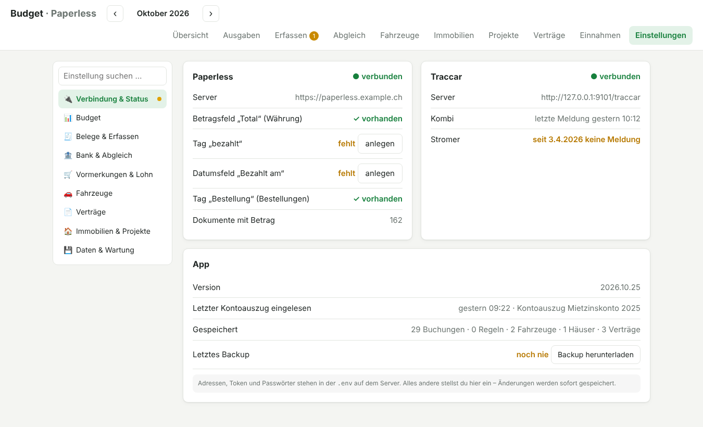

### Zweck und „nicht berücksichtigen“

In der Übersicht (Liste „Ausgaben im Monat“), unter *Ausgaben* und beim *Erfassen* steht bei jedem Beleg,
wofür er ist. Die App liest das aus dem OCR-Text – in dieser Reihenfolge: Betreff/Zahlungszweck,
„Zusätzliche Informationen“ der QR-Rechnung, Betreffzeile („Rechnung für …“), erste Artikelposition.
Ein Leistungszeitraum wird angehängt. Mit ✎ korrigierst du den Zweck; die Korrektur bleibt gespeichert.

Entfernst du das Häkchen, zählt der Beleg nicht mehr zum Budget und erscheint weder beim Erfassen noch bei den
offenen Rechnungen. Beim Abgleich wird er trotzdem gefunden – so zählt auch die zugehörige Bankzahlung nicht
als Ausgabe. Bei Bankbuchungen ohne Beleg entspricht das Häkchen dem „Ignorieren“.

Tipp: Ein Paperless-**Workflow** kann neuen Rechnungen das Betrags-Feld automatisch (leer) zuweisen und
Matching-Regeln die Kategorie-Tags setzen – dann muss man in der App nur noch den Betrag eintippen.

## Kontoauszüge abgleichen

1. Kontoauszüge als PDF in Paperless ablegen, z.B. mit Dokumenttyp *Kontoauszug*.
2. **Einstellungen → Kontoauszüge & Abgleich**: diesen Dokumenttyp (oder einen Tag) wählen.
3. **Abgleich → Neue einlesen**.
4. **Eindeutige zuordnen** übernimmt alle Treffer, bei denen Betrag *und* Name passen. Bei wiederkehrenden
   Rechnungen mit gleichem Betrag (Miete, Prämien, Abos) gewinnt die zeitlich nächste.
   Treffer nur über den Betrag bleiben Vorschläge zum Bestätigen.
5. Für Zahlungen ohne Beleg eine Kategorie wählen oder eine **Regel** anlegen. Mehrere Begriffe lassen sich
   mit `+` verbinden, auch mit Karten-Endziffern, z.B. `Tankomat + 1234` → Fahrzeug.
6. Umbuchungen zwischen eigenen Konten **ignorieren**, damit sie nicht als Ausgabe zählen.

Eine zugeordnete Zahlung zählt nicht doppelt – nur die Rechnung (zum Rechnungsdatum).

### Unterstützte Banken

Der Leser erkennt zwei verbreitete Layouts automatisch:

| Layout | Spalten | Getestet mit |
|---|---|---|
| A | `[Datum] Text Betrag Valuta [Saldo]` | PostFinance, Zürcher Kantonalbank |
| B | `Datum Text Valuta Betrag [Saldo]` | Bank Zimmerberg |
| Einzelbeleg | Gutschrifts-/Belastungsanzeige: `Referenz Valuta Währung Betrag` | Zürcher Kantonalbank |

Einzelbelege (z.B. die ZKB-Gutschriftsanzeige einer Mietzahlung) werden wie ein Auszug mit einer Buchung behandelt –
dafür den Dokumenttyp bzw. Tag dieser Belege ebenfalls unter *Einstellungen → Bank* als Kontoauszug wählen. Erscheint
dieselbe Buchung später im Monatsauszug (gleicher Betrag, ±4 Tage), wird sie nicht doppelt erfasst.

Andere Banken mit ähnlichem Aufbau funktionieren oft ebenfalls. Ob alles stimmt, sieht man sofort: Buchungen,
deren Vorzeichen nicht über den Saldo bestätigt werden konnte, sind als „ungeprüft“ markiert.

**Deine Bank funktioniert nicht?** Gerne ein Issue eröffnen mit dem OCR-Text eines Auszugs
(Paperless → Dokument → Reiter *Inhalt*) – **vorher IBAN, Kontonummer, Namen und Adresse unkenntlich machen.**

## Immobilien einrichten

1. **Immobilien → + Haus**, dann unter **Einrichtung**: Adresse, Vermieter, IBAN, Beginn der Abrechnungsperiode
   (z.B. März), Paperless-Tag für die Belege des Hauses.
2. **Wohnungen** erfassen (Fläche, selbst bewohnt).
3. **Standard-Schlüssel & Kostenarten anlegen** – danach die Prozente pro Wohnung eintragen (Summe 100 %),
   Raumheizung/Warmwasser-Schlüssel wählen und Kostenarten nach Bedarf anpassen.
4. **Mietverhältnisse**: Mieter, Adresse, Anrede, Beginn/Ende, Miete und Akonto pro Monat und Stichworte
   für die Mietzahlung (z.B. Nachname).
5. **Fixkosten** und **manuelle Kosten** ergänzen (pro Jahr/Monat bzw. einmalig, verteilt oder nur eine Wohnung).
6. Unter **Kosten** prüfen, ob jeder Beleg die richtige Kostenart hat. „Nicht umlegbar“ (z.B. Unterhalt am Gebäude)
   bleibt Eigentümersache.
7. **Abrechnung**: Mieter wählen, Akonto prüfen (aus den Mietzinseingängen bzw. laut Vertrag), erzeugen.
   Das Word-Dokument folgt dem klassischen Aufbau: Brief, Kostenübersicht mit farbigen Gruppen, Detailseiten
   mit Zuweisung (Anteile, CHF pro Einheit, Ihr Anteil) und optional Heizöl-Verbrauch.
8. **Zwischenabrechnung** (z.B. bei Auszug): unter *Abrechnung* Art „Zwischenabrechnung“ wählen und den Zeitraum
   bis zum Stichtag setzen. Es zählen die bis dahin verbuchten Kosten, Akonto nur für die Monate im Zeitraum.

**Heizöl nach Verbrauch:** In der Einrichtung unter *Heizöl-Lagerbestand* die Kostenart Heizöl wählen und den
Tankstand (Liter, Preis pro 100 l) zu Beginn und Ende der Periode erfassen – bzw. am Stichtag einer
Zwischenabrechnung. Dann rechnet die App Anfangsbestand + Einkäufe − Endbestand statt der Einkäufe.
Zusätzlich lassen sich **Lieferungen** (Datum, Liter, Betrag) erfassen: Daraus berechnet die App den gleitenden
**Durchschnittspreis pro 100 l** des Tankinhalts – (Restwert + Lieferungen) ÷ (Restmenge + gelieferte Liter). Bei einer
Ablesung gilt dieser Durchschnitt; ein erfasster Preis zählt nur für den Anfangsbestand (solange noch kein Durchschnitt da ist). Sind Lieferungen erfasst, ersetzen sie die Heizöl-Belege in der Abrechnung.

So wird gerechnet: Anteil = Betrag × Schlüssel der Wohnung × Nutzungstage ÷ Periodentage. Individuell belastete
Positionen zählen voll, wenn sie in die Mietdauer fallen. Den Anteil von Leerständen trägt der Eigentümer.
Liegenschaftskosten zählen standardmässig nicht zum Haushaltsbudget (abschaltbar).

## Fahrzeuge

1. In der `.env` `TRACCAR_URL` und `TRACCAR_TOKEN` (oder `TRACCAR_USER` / `TRACCAR_PASSWORD`) setzen.
2. In Paperless pro Fahrzeug einen Tag anlegen (z.B. „Fz Kombi“) und an Service-, Versicherungs-,
   Steuer- und Reparaturbelege hängen.
3. **Einstellungen → Fahrzeuge**: Fahrzeug mit Antrieb, Traccar-Gerät, Paperless-Tag und Tankkarten-Nr.
   anlegen (Endziffern genügen, mehrere mit Komma). Darunter den Korrespondenten der Tankkarten-Rechnungen
   wählen.
4. **Fahrzeuge → Neue einlesen** liest die Tankkarten-Rechnungen (Vögtlin-Meyer und AVIA / A.H. Meyer & Cie AG –
   bei AVIA hat jedes Fahrzeug eine eigene Karten-Nr.; mehrere Nummern pro Fahrzeug mit Komma eintragen).
   Ist der OCR-Text in Paperless spaltenweise durcheinander, liest die App den Text direkt aus dem PDF.
5. Tankvorgänge mit Debitkarte im Abgleich oder per Regel dem Fahrzeug zuordnen. Für einen korrekten
   Verbrauch die Liter über „Tankvorgang manuell erfassen“ ergänzen – oder bei Elektroautos die geladenen kWh.

Der Verbrauch wird nur aus Monaten berechnet, in denen jeder Tankvorgang eine Mengenangabe hat.

**Parkingpay:** Die Parkingpay-Auszüge (PDF aus dem Parkingpay-Konto) in Paperless ablegen und unter
*Einstellungen → Fahrzeuge → Parkingpay-Auszüge erkennen* den Korrespondenten oder Tag wählen. Bei jedem Fahrzeug
das **Kennzeichen** (bzw. die Badge-Nr.) eintragen. Unter *Fahrzeuge → Parkingpay-Auszüge → Neue einlesen* liest die App jeden
Parkvorgang (Datum, Zeit, Ort, Kennzeichen, Betrag) und ordnet ihn dem Fahrzeug zu; unbekannte Kennzeichen lassen
sich einzeln zuordnen. Im Budget zählt weiterhin die Zahlung an Parkingpay (Aufladung oder Rechnung) – die
Aufladungen deshalb keinem Fahrzeug zuordnen, sonst zählen sie dort doppelt.
Im Parkhaus steht im Auszug statt des Kennzeichens oft die Parkingpay-Badge-Nr. – diese beim Fahrzeug einfach
ebenfalls eintragen (Feld „Kennzeichen / Badge-Nr.“, kommagetrennt).


**km-Quelle:** Standard ist der Traccar-Bericht. Liefert ein Gerät einen falschen oder eingefrorenen
Kilometerzähler, kann pro Fahrzeug „km: aus GPS berechnen“ gewählt werden – die App rechnet die Strecke
dann selbst aus den GPS-Positionen (einmalig im Hintergrund, danach zwischengespeichert).

## Bestellungen automatisch vormerken (E-Mail)

1. In Paperless einen Tag **Bestellung** anlegen (anderer Name: `ORDER_TAG_NAME` in der `.env`).
2. Paperless → **E-Mail**: Mailkonto hinzufügen und eine Regel anlegen, z.B.
   - Betreff enthält `Bestellbestätigung` (oder Absender `@galaxus.ch`, `@digitec.ch`, `@zalando.ch` …)
   - Aktion: *Mail als .eml verarbeiten* bzw. *Mail und Anhänge* – Tag **Bestellung** zuweisen,
     Korrespondent aus dem Absender
3. Die App übernimmt neue Bestellbestätigungen beim Öffnen der Übersicht. Erkennt sie den Betrag nicht,
   in Paperless das Feld „Total“ setzen oder die Vormerkung in der App bearbeiten.

Dokumente mit dem Tag „Bestellung“ zählen nie als Ausgabe – gezählt wird später die Rechnung oder Abbuchung.
Die Rechnung bzw. Abbuchung wird standardmässig 30 Tage nach der Bestellung erwartet (`ORDER_EXPECT_DAYS`).

## Verträge & Kredite

Im Tab **Verträge** werden laufende Verträge (Versicherungen, Krankenkasse, Telefon/Internet, Energie,
Abos …) und Kredite (Hypothek, Leasing, Privatkredit) verwaltet:

- **Versionen**: jede Preis- oder Konditionsänderung ab Datum, optional mit Paperless-Beleg
  („→ als Version“ übernimmt Datum und Betrag aus einer Rechnung)
- **Kosten** pro Intervall, pro Monat und pro Jahr – Summen oben im Tab
- **Laufzeit und Kündigung**: aus Beginn, Verlängerung (Monate) und Kündigungsfrist wird der nächste
  Kündigungstermin berechnet; Termine in den nächsten 4 Monaten werden hervorgehoben
- **Zahlungen** aus den Kontoauszügen: über „Stichworte Bankbuchung“ automatisch zugeordnet oder manuell;
  Vergleich bezahlt / erwartet pro Jahr
- **Dokumente**: alle Paperless-Dokumente des gewählten Korrespondenten und/oder Tags
- **Kredite**: Restschuld nach Plan (Anfangsbetrag minus Amortisation), Zins pro Jahr,
  Restschuld-Verlauf der nächsten Jahre. Bleibt der Betrag leer, wird die Rate aus Zins und Amortisation berechnet.

## Zähler (AMS-Leser, Shelly, Home Assistant)

Im Tab *Zähler* einen Zähler hinzufügen:

- **Strom (AMS-Leser)**: IP-Adresse des AMS-Lesers eintragen (z.B. `192.168.1.50`). Gelesen wird `http://<ip>/data.json`,
  Feld `ic` = Bezug kumuliert in kWh (für Einspeisung `ec`). Der Container muss den Leser im Netz erreichen.
- **Wasser (Shelly, vormerken)**: legt einen inaktiven Zähler an. Sobald der Shelly montiert ist, die Adresse eintragen
  (z.B. `http://<shelly-ip>/rpc/Input.GetStatus?id=2`, Feld `counts.total`), Faktor anpassen
  (Impulse pro Liter → `0.001` ergibt m³), *Quelle testen* und *aktiv* setzen.
- **Home Assistant**: `HOMEASSISTANT_URL` und `HOMEASSISTANT_TOKEN` (langlebiges Zugriffstoken) in der `.env` setzen und die
  Entitäts-ID eines Zählerstand-Sensors angeben (kein Momentanwert in W).
- **von Hand**: Zählerstände selbst erfassen (*Stand erfassen*), z.B. vom alten Wasserzähler.

Für die Prognose unter *Einstellungen* des Zählers ausfüllen: **Tarif** pro kWh bzw. m³ (alle Komponenten inkl. MWST),
**Grundgebühr** pro Monat, Beginn der **Abrechnungsperiode**, den **Zählerstand der letzten Rechnung** (sonst zählt die
erste Ablesung als Start) und den **Akonto-Vertrag**. Den Akonto-Vertrag unter *Verträge* erfassen (Betrag, Intervall und
Stichwort im Buchungstext) – die bezahlten Akonto-Zahlungen kommen aus den Kontoauszügen, die noch fälligen aus dem Vertrag.

**Zuordnung:** Pro AMS-Leser einen Zähler anlegen und unter *Zuordnung* das **Haus (allgemein)** – z.B. Allgemeinstrom –
oder eine **Wohnung** wählen. Die Zähler erscheinen nach Haus gruppiert. Zahlt ein Mieter den Strom direkt dem Werk, einfach
keinen Akonto-Vertrag wählen – dann zeigt der Zähler nur Verbrauch und geschätzte Kosten.

In der Nebenkostenabrechnung (Vorschau und Word/PDF) stehen bei Zählern „Haus (allgemein)“ die **erwarteten** Kosten der
NK-Periode (Verbrauch × Tarif + Grundgebühr) in Klammern hinter der Kategorie, z.B. „Strom Allgemein (erwartet 1'318.73)“.
Abgerechnet wird weiterhin nach den Rechnungen. Die Kategorie wählst du beim Zähler unter *In der NK anzeigen bei*
(leer = Kategorie mit „Strom“ im Namen).

Abgelesen wird alle `METER_POLL_MINUTES` (Standard 60) und beim Öffnen des Tabs. Ab dem zweiten Jahr rechnet die Prognose
den Rest der Periode mit dem Verbrauch des Vorjahres hoch, vorher mit dem Tagesdurchschnitt. Das Resultat ist eine
Schätzung – Tarifänderungen und Ablesedatum des Werks können abweichen.

## Benutzer & Rechte

Ohne Benutzer ist die App offen (bzw. per `BASIC_AUTH_USER` geschützt). Unter *Einstellungen → Benutzer & Rechte* legst du
zuerst deinen eigenen Zugang als **Administrator** an – danach meldet sich jeder mit Benutzername und Passwort an.

Pro Benutzer und Bereich (Budget, Abgleich, Fahrzeuge, Immobilien, Projekte, Verträge & Abos, Einnahmen & Lohn, Zähler & Energie):
**–** = nicht sichtbar, **ansehen** = nur lesen, **bearbeiten** = ändern. Administratoren dürfen zusätzlich Einstellungen,
Benutzer, Backup und Export. Der Server prüft die Rechte bei jeder Anfrage; ohne Recht auf „Einnahmen & Lohn“ sind
Einnahmen auch in der Übersicht ausgeblendet. Der letzte Administrator kann nicht gelöscht oder herabgestuft werden.
Passwörter werden gehasht gespeichert (PBKDF2), Sitzungen laufen 30 Tage. Jeder Benutzer ändert sein Passwort unter *Konto*.

**Passwort des Administrators vergessen?** Auf dem Server alle Benutzer entfernen – danach ist die App wieder offen und du
legst den Administrator neu an:
```bash
docker exec paperless-budget python -c "import sqlite3;c=sqlite3.connect('/data/budget.db');c.execute('DELETE FROM sessions');c.execute('DELETE FROM users');c.commit()"
```

## Konfiguration

In der `.env` stehen Adressen und Zugangsdaten. Namen von Tags und Feldern (`AMOUNT_FIELD_NAME`, `PAID_*`,
`ORDER_*`, `NK_TAG_NAME`) sind nur Startwerte – sie lassen sich danach in der App unter *Einstellungen* ändern.

| Variable | Standard | Bedeutung |
|---|---|---|
| `PAPERLESS_URL` | `http://paperless:8000` | Adresse, unter der der Container Paperless erreicht |
| `PAPERLESS_TOKEN` | – | API-Token |
| `PAPERLESS_PUBLIC_URL` | = `PAPERLESS_URL` | Für die Links „Dokument öffnen“ im Browser |
| `PAPERLESS_VERIFY_SSL` | `true` | `false` bei selbstsigniertem Zertifikat |
| `PAPERLESS_API_VERSION` | leer | API-Version fixieren, falls nötig |
| `AMOUNT_FIELD_NAME` | `Total` | Name des Währungs-Felds (Gross-/Kleinschreibung egal) |
| `CURRENCY` | `CHF` | Währung |
| `PAID_TAG_NAME` | `bezahlt` | Tag für bezahlte Rechnungen |
| `PAID_FIELD_NAME` | `Bezahlt am` | Datumsfeld für das Zahlungsdatum |
| `MATCH_BEFORE_DAYS` | `5` | Rechnung darf so viele Tage nach der Zahlung datiert sein |
| `TRACCAR_URL` | leer | Traccar-Server, z.B. `http://traccar:8082` |
| `TRACCAR_TOKEN` | leer | Traccar-Token (alternativ `TRACCAR_USER` / `TRACCAR_PASSWORD`) |
| `TRACCAR_VERIFY_SSL` | `true` | `false` bei selbstsigniertem Zertifikat |
| `HOMEASSISTANT_URL` | leer | Home Assistant für Zähler-Sensoren, z.B. `http://homeassistant:8123` |
| `HOMEASSISTANT_TOKEN` | leer | Langlebiges Zugriffstoken aus dem Home-Assistant-Profil |
| `METER_POLL_MINUTES` | `60` | Wie oft die Zähler abgelesen werden |
| `NK_TAG_NAME` | `Nebenkostenabrechnung` | Tag für in Paperless abgelegte Abrechnungen |
| `FILES_DIR` | `/data/abrechnungen` | Ablage der erzeugten Word-/PDF-Dateien |
| `BASIC_AUTH_USER` / `BASIC_AUTH_PASSWORD` | leer | Optionaler Login |

Budgets, Einnahmen, Regeln, eingelesene Buchungen und Fahrzeuge liegen in `./data/budget.db` (SQLite) –
diesen Ordner ins Backup aufnehmen oder unter *Einstellungen → Daten & Wartung* ein Backup herunterladen.

## Was in Paperless verändert wird

Die App schreibt nur, wenn du es auslöst:

- Betrag (Währungs-Feld) und Kategorie-Tag beim Erfassen bzw. Ändern einer Ausgabe
- Tag „bezahlt“ und Feld „Bezahlt am“ beim Zuordnen einer Zahlung (Lösen entfernt beides wieder)
- einmalig das Betrags-Feld, den Tag „bezahlt“ und das Feld „Bezahlt am“, falls sie fehlen

Alle anderen Custom Fields und Tags eines Dokuments bleiben unverändert. Zweck und „nicht berücksichtigen“
speichert die App nur in ihrer eigenen Datenbank – Paperless bleibt davon unberührt.

## Aufbau

```
app/main.py          FastAPI-Backend: Proxy zur Paperless-/Traccar-API, SQLite, Auswertungen
app/bank.py          Kontoauszug-Leser und Abgleich-Logik
app/vehicles.py      Tankkarten-Rechnungen lesen, Fahrzeug-Kennzahlen
app/parking.py       Parkingpay-Auszüge lesen (Parkvorgänge mit Kennzeichen)
app/payslip.py       Lohnabrechnungen lesen (Brutto, Abzüge, Netto, Auszahlung)
app/purpose.py       Zweck aus dem Rechnungstext lesen
app/realestate.py    Nebenkosten berechnen, Abrechnung als Word erzeugen
app/re_api.py        API für Liegenschaften, Mieten, Projekte und Zuordnungen
app/contracts_api.py Verträge und Kredite (Versionen, Zahlungen, Kündigungstermine, Restschuld)
app/meters_api.py    Zähler ablesen (AMS, HTTP-JSON, Home Assistant), Prognose und Akonto-Saldo
app/planning_api.py  Vormerkungen (Bestellungen) und „Rest vom Lohn“
app/static/settings.js  Einstellungen (Rubriken, Sofort-Speichern, Status, Backup, Benutzer)
app/auth.py          Benutzer & Rechte: Passwort-Hashing, Zuordnung der API-Routen zu Bereichen
app/static/          Frontend (HTML, CSS, Vanilla JS, Chart.js lokal eingebunden)
```

Der Paperless-Token bleibt im Backend, der Browser spricht nur mit der App.
Die API ist unter `/docs` (Swagger UI) dokumentiert.

### Lokal entwickeln

```bash
pip install -r requirements.txt
PAPERLESS_URL=http://localhost:8000 PAPERLESS_TOKEN=... DB_PATH=./data/budget.db \
  uvicorn app.main:app --reload --port 8088
```

## Grenzen

- Kontoauszüge werden aus dem OCR-Text gelesen. Schlechte Scans oder ungewöhnliche Layouts können
  fehlschlagen – digital erzeugte PDFs aus dem E-Banking funktionieren am besten.
- Nur eine Währung pro Installation.
- Oberfläche nur auf Deutsch.
- Kein Mehrbenutzer-System: Alle, die Zugriff auf die App haben, sehen alle Daten.
- Heiz-/Warmwasserkosten werden mit festen Prozenten verteilt; eine Abrechnung nach Zählerablesung (HKV) ist nicht eingebaut.
- Das Docker-Image enthält LibreOffice (für die PDF-Erzeugung) und ist dadurch etwa 600 MB gross.
- Die Abrechnung ist ein Hilfsmittel – rechtliche Anforderungen (Mietvertrag, OR) bitte selbst prüfen.

## Mitwirken

Issues und Pull Requests sind willkommen – besonders Beispiele weiterer Bank- und Tankkarten-Layouts
(immer anonymisiert).

## Lizenz

[MIT](LICENSE)

Nicht offiziell mit Paperless-ngx oder Traccar verbunden.
Chart.js ist unter der MIT-Lizenz enthalten.
